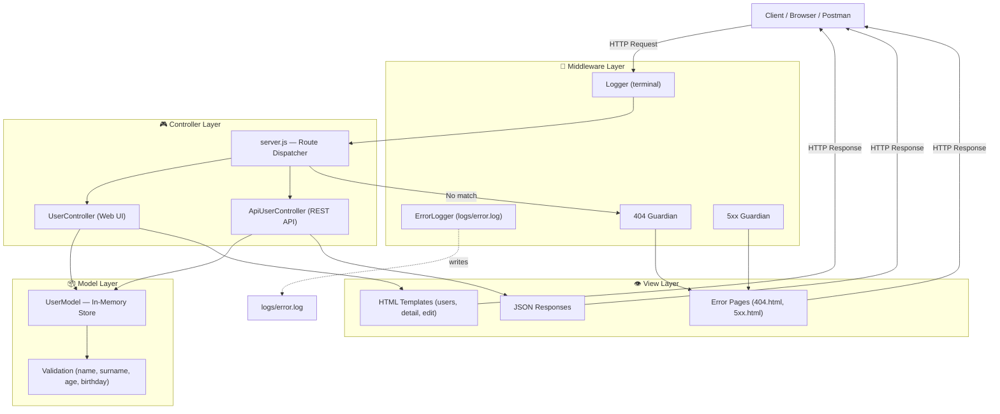

# Alumni Tracking System

A comprehensive Alumni Tracking System designed to manage, connect, and engage with university/school alumni. The platform provides a centralized hub for tracking alumni data, fostering networking opportunities, and maintaining strong relationships between the institution and its graduates.

## 🚀 Technologies Used

- **Backend:** Node.js (built-in `http` module — no external frameworks)
- **Frontend:** HTML5, CSS3, Vanilla JavaScript
- **Architecture:** MVC (Model-View-Controller)
- **API Docs:** Swagger / OpenAPI 3.0

## ✨ Features

- **Full CRUD** for alumni records via both a Web UI and a REST JSON API
- **Request Logger:** Every request printed to the terminal with color-coded status codes and response times
- **Error Logging:** All 4xx/5xx responses automatically appended to `logs/error.log`
- **Themed Error Pages:** Custom 404 and 5xx pages with context-aware reasons, matching the project's design
- **Swagger UI** interactive API documentation at `/api/swagger`
- **Responsive Design** with consistent Alumni Network branding

---

## 🗂️ Project Structure

```
alumni/
├── controllers/
│   ├── apiUserController.js    # [CONTROLLER] REST API — JSON responses
│   └── userController.js       # [CONTROLLER] Web UI — HTML template rendering
├── middleware/
│   ├── logger.js               # [MIDDLEWARE] Terminal request logger (color-coded)
│   ├── errorLogger.js          # [MIDDLEWARE] File logger → logs/error.log
│   ├── notFoundHandler.js      # [MIDDLEWARE] 404 Guardian — themed 404 page
│   └── errorHandler.js         # [MIDDLEWARE] 5xx Guardian — themed server error page
├── models/
│   └── userModel.js            # [MODEL] In-memory Alumni data model + validation
├── routes/
│   ├── apiUserRoutes.js        # [ROUTER] /api/users endpoints
│   └── userRoutes.js           # [ROUTER] /users endpoints (Web UI)
├── views/
│   ├── users.html              # Alumni directory + registration form
│   ├── user-detail.html        # Single alumnus profile
│   ├── user-edit.html          # Edit form
│   ├── 404.html                # Themed 404 error page
│   └── 5xx.html                # Themed 5xx error page
├── logs/
│   ├── .gitkeep                # Keeps the logs/ folder in git
│   └── error.log               # Auto-generated — all error requests (gitignored)
├── index.html                  # Home page
├── about.html                  # About page
├── swagger.html                # Swagger UI
├── swagger.json                # OpenAPI 3.0 spec
├── server.js                   # Entry point — HTTP server + middleware wiring
├── ddd.md                      # Domain-Driven Design rules & validation
├── README.md                   # This file
└── .gitignore
```

---

## 🏛️ MVC Architecture



---

## 🔌 REST API Endpoints

| Method | Endpoint | Description |
|--------|----------|-------------|
| GET | `/api/users` | List all alumni |
| GET | `/api/users/:id` | Get a single alumnus by ID |
| POST | `/api/users` | Create a new alumnus |
| PUT | `/api/users/:id` | Full update (all fields required) |
| PATCH | `/api/users/:id` | Partial update |
| DELETE | `/api/users/:id` | Delete an alumnus |
| GET | `/api/swagger` | Interactive Swagger UI |
| GET | `/api/swagger.json` | OpenAPI 3.0 spec |
| GET | `/api/health` | Health check |

## 🌐 Web UI Routes

| Method | URL | Description |
|--------|-----|-------------|
| GET | `/users` | Alumni directory + registration form |
| POST | `/users` | Submit registration form |
| GET | `/users/:id` | View alumnus profile |
| GET | `/users/:id/edit` | Edit form (pre-filled) |
| POST | `/users/:id/edit` | Submit edit form |
| POST | `/users/:id/delete` | Delete via form submit |

---

## 🔧 Middleware

### 1. Logger (`middleware/logger.js`)
Logs **every** HTTP request to the terminal:
```
[2026-11-11 23:40:00] GET     /users 200 12ms - Mozilla/5.0...
```
Color codes: 🟢 2xx · 🟡 3xx · 🔴 4xx · 🟣 5xx

### 2. Error Logger (`middleware/errorLogger.js`)
Automatically appends all 4xx/5xx responses to **`logs/error.log`**:
```
[2026-11-11T20:40:00.000Z] 404 | GET /users/999
Error: HTTP 404
UA: Mozilla/5.0...
IP: ::1
---
```
Also exposes `logError(req, error, statusCode)` for manual logging.

### 3. 404 Guardian (`middleware/notFoundHandler.js`)
Handles all unmatched routes with:
- **Context-aware reasons** (different messages for `/api/*`, `/users/*`, etc.)
- **Themed HTML page** (`views/404.html`) for browser requests
- **JSON response** for API requests (`Accept: application/json` or `/api/*`)

### 4. 5xx Guardian (`middleware/errorHandler.js`)
Handles all server errors with:
- **Sanitized messages** (no stack traces exposed to clients)
- **Themed HTML page** (`views/5xx.html`) for browser requests
- **JSON response** for API consumers

---

## 📋 Validation Rules (see `ddd.md` for full detail)

| Field | Required | Type | Constraints |
|-------|----------|------|-------------|
| `name` | ✅ | String | Max 50 chars |
| `surname` | ✅ | String | Max 50 chars |
| `age` | ✅ | Number | 0–120, integer |
| `birthday` | ✅ | String | YYYY-MM-DD format |

---

## ▶️ Getting Started

```bash
# Start the server
node server.js

# Access the app
open http://localhost:8080
open http://localhost:8080/users
open http://localhost:8080/api/swagger
```

---

## 📅 Changelog

### Week 7 — November 11, 2026
- **`ddd.md`** — Added Domain-Driven Design rules & validation documentation (Alumni, Job Posting, Event entities)
- **`middleware/logger.js`** — Request logger middleware: color-coded terminal output for every request
- **`middleware/errorLogger.js`** — Error file logger: auto-writes 4xx/5xx requests to `logs/error.log`
- **`middleware/notFoundHandler.js`** — 404 Guardian: context-aware themed 404 page or JSON
- **`middleware/errorHandler.js`** — 5xx Guardian: themed server error page or JSON (sanitized)
- **`views/404.html`** — Themed 404 error page with animations and helpful links
- **`views/5xx.html`** — Themed 5xx error page with animations and retry option
- **`logs/.gitkeep`** — Error log directory (tracked in git, log files excluded)
- **`server.js`** — Integrated all middleware; generic 404 now uses notFoundHandler
- **`.gitignore`** — Added to exclude log files and OS artifacts

### Week 6
- Defined full CRUD operations on user route, controller, and view
- Added `views/user-detail.html` and `views/user-edit.html` templates
- Implemented edit form (GET/POST `/users/:id/edit`) and delete via form POST
- Added Actions column (view/edit/delete) to alumni table


---

## 📅 Week 7 — November 11, 2026

### New: Middleware Layer

| File | Description |
|------|-------------|
| `middleware/logger.js` | Terminal request logger — color-coded output for every request (green 2xx, yellow 3xx, red 4xx, magenta 5xx) |
| `middleware/errorLogger.js` | File logger — auto-writes all 4xx/5xx responses to `logs/error.log` |
| `middleware/notFoundHandler.js` | 404 Guardian — context-aware themed 404 page or JSON |
| `middleware/errorHandler.js` | 5xx Guardian — themed server error page or JSON (sanitized messages) |

### New: Themed Error Pages

| File | Description |
|------|-------------|
| `views/404.html` | Animated 404 page with context-aware reason, project design theme, and helpful navigation |
| `views/5xx.html` | Animated 5xx page with error code, reason placeholder, and retry button |

### New: Error Logging

- `logs/` directory created (tracked via `.gitkeep`, log files gitignored)
- All 4xx/5xx requests are automatically appended to `logs/error.log`

### Updated: `server.js`

- Integrated all 4 middleware layers on every request
- Generic 404 fallback now uses themed `notFoundHandler` instead of plain text
- All file-read errors bubble to `errorHandler` (500)

### New: `ddd.md` additions

- Updated with Job Posting and Event entity validation rules
- Added validation summary table, aggregates, and bounded context definitions
