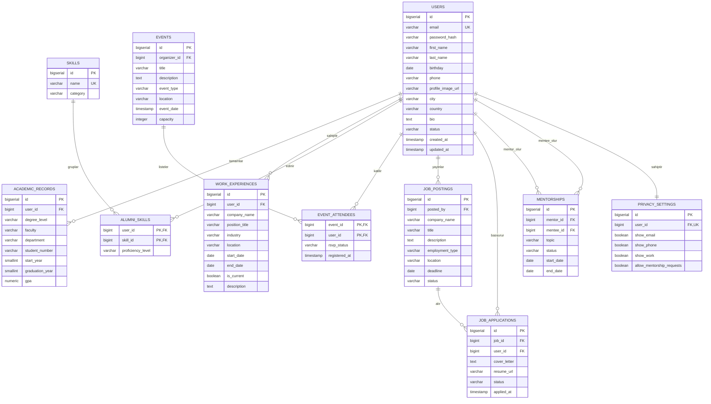

# Data Design Documentation (DDD) - Mezun Takip Sistemi

Bu döküman, **Mezun Takip Sistemi (Alumni Tracking System)** uygulamasının veritabanı mimarisini, veri modellerini, tablo şemalarını, ilişkilerini ve veri sözlüğünü (Data Dictionary) kapsamlı bir şekilde tanımlar.

---

## 📌 İçindekiler
1. [Sistem Genel Bakışı ve Veri Mimarisi](#1-sistem-genel-bak%C4%B1%C5%9F%C4%B1-ve-veri-mimarisi)
2. [Varlık-İlişki Diyagramı (ER Diagram)](#2-varl%C4%B1k-%C4%B0li%C5%9Fki-diyagram%C4%B1-er-diagram)
3. [Veri Sözlüğü ve Tablo Şemaları](#3-veri-s%C3%B6zl%C3%BC%C4%9F%C3%BC-ve-tablo-%C5%9Femalar%C4%B1)
   - [3.1. users (Kullanıcılar / Mezunlar)](#31-users-kullan%C4%B1c%C4%B1lar--mezunlar)
   - [3.2. academic_records (Eğitim ve Mezuniyet Bilgileri)](#32-academic_records-e%C4%9Fitim-ve-mezuniyet-bilgileri)
   - [3.3. work_experiences (İş Deneyimleri ve Kariyer)](#33-work_experiences-%C4%B0%C5%9F-deneyimleri-ve-kariyer)
   - [3.4. skills & alumni_skills (Yetkinlikler ve Eşleştirmeler)](#34-skills--alumni_skills-yetkinlikler-ve-e%C5%9Fle%C5%9Ftirmeler)
   - [3.5. events & event_attendees (Etkinlikler ve Katılım)](#35-events--event_attendees-etkinlikler-ve-kat%C4%B1l%C4%B1m)
   - [3.6. job_postings & job_applications (Kariyer İlanları ve Başvurular)](#36-job_postings--job_applications-kariyer-%C4%B0lanlar%C4%B1-ve-ba%C5%9Fvurular)
   - [3.7. mentorships (Mentorluk İlişkileri)](#37-mentorships-mentorluk-%C4%B0li%C5%9Fkileri)
   - [3.8. privacy_settings (Gizlilik ve KVKK Tercihleri)](#38-privacy_settings-gizlilik-ve-kvkk-tercihleri)
4. [İlişki Türleri ve Bütünlük Kuralları (Referential Integrity)](#4-%C4%B0li%C5%9Fki-t%C3%BCrleri-ve-b%C3%BCt%C3%BCnl%C3%BCk-kurallar%C4%B1)
5. [İndeksleme ve Performans Optimizasyonu](#5-%C4%B0ndeksleme-ve-performans-optimizasyonu)
6. [PostgreSQL DDL (Veritabanı Oluşturma Betiği)](#6-postgresql-ddl-veritaban%C4%B1-olu%C5%9Fturma-beti%C4%9Fi)

---

## 1. Sistem Genel Bakışı ve Veri Mimarisi

Mezun Takip Sistemi'nin veri katmanı, ilişkisel veritabanı yönetim sistemi (RDBMS) olarak **PostgreSQL** üzerinde çalışacak şekilde modellenmiştir.

### Temel Hedefler:
* **Veri Tutarlılığı (ACID):** Mezuniyet kayıtları, iş tecrübeleri ve iletişim bilgilerinde yüksek tutarlılık.
* **Normalize Yapı (3NF):** Veri tekrarını önlemek amacıyla 3. Normal Form (3NF) standartlarına uygun tasarım.
* **Esnek ve Modüler Genişleyebilirlik:** İş ilanları, mentorluk ve etkinlik modüllerinin çekirdek kullanıcı tablosuna gevşek bağlı (loosely coupled) entegrasyonu.
* **Gizlilik ve KVKK Uyumu:** Mezunların iletişim bilgilerinin diğer kullanıcılar tarafından ne ölçüde görüntülenebileceğini denetleyen granüler gizlilik kontrolü.

---

## 2. Varlık-İlişki Diyagramı (ER Diagram)

Aşağıdaki diyagram sistemdeki ana varlıkları ve aralarındaki cardinalite ilişkilerini gösterir:



---

## 3. Veri Sözlüğü ve Tablo Şemaları

### 3.1. `users` (Kullanıcılar / Mezunlar)
Sistemin çekirdek tablosudur. Kimlik doğrulama ve genel profil bilgilerini saklar.

| Kolon Adı | Veri Tipi | Kısıtlar (Constraints) | Açıklama |
| :--- | :--- | :--- | :--- |
| `id` | `BIGSERIAL` | `PRIMARY KEY` | Benzersiz kullanıcı kimliği. |
| `email` | `VARCHAR(255)` | `NOT NULL`, `UNIQUE` | E-posta adresi (giriş için kullanılır). |
| `password_hash` | `VARCHAR(255)` | `NOT NULL` | Güvenli hashlenmiş parola (bcrypt/argon2). |
| `first_name` | `VARCHAR(100)` | `NOT NULL` | Mezunun adı. |
| `last_name` | `VARCHAR(100)` | `NOT NULL` | Mezunun soyadı. |
| `birthday` | `DATE` | `NULL` | Doğum tarihi. |
| `phone` | `VARCHAR(30)` | `NULL` | İletişim telefon numarası. |
| `profile_image_url` | `VARCHAR(500)` | `NULL` | Profil fotoğrafı bağlantısı. |
| `city` | `VARCHAR(100)` | `NULL` | İkamet edilen şehir. |
| `country` | `VARCHAR(100)` | `DEFAULT 'Türkiye'` | İkamet edilen ülke. |
| `bio` | `TEXT` | `NULL` | Mezunun kendini tanıttığı özet metin. |
| `status` | `VARCHAR(20)` | `DEFAULT 'active'` | Durum: `active`, `pending_approval`, `suspended`. |
| `created_at` | `TIMESTAMPTZ` | `DEFAULT NOW()` | Kayıt oluşturulma zamanı. |
| `updated_at` | `TIMESTAMPTZ` | `DEFAULT NOW()` | Son güncelleme zamanı. |

---

### 3.2. `academic_records` (Eğitim ve Mezuniyet Bilgileri)
Mezunun üniversitede tamamladığı eğitim programlarını tutar. Bir mezunun birden fazla derecesi (Lisans, Yüksek Lisans vb.) olabilir (1:N).

| Kolon Adı | Veri Tipi | Kısıtlar | Açıklama |
| :--- | :--- | :--- | :--- |
| `id` | `BIGSERIAL` | `PRIMARY KEY` | Kayıt kimliği. |
| `user_id` | `BIGINT` | `NOT NULL`, `FK -> users(id) ON DELETE CASCADE` | İlgili mezun referansı. |
| `degree_level` | `VARCHAR(50)` | `NOT NULL` | Derece seviyesi: `Lisans`, `Yüksek Lisans`, `Doktora`, `Ön Lisans`. |
| `faculty` | `VARCHAR(150)` | `NOT NULL` | Fakülte adı (örn. Mühendislik Fakültesi). |
| `department` | `VARCHAR(150)` | `NOT NULL` | Bölüm / Program (örn. Bilgisayar Mühendisliği). |
| `student_number` | `VARCHAR(50)` | `NULL` | Üniversite öğrenci numarası. |
| `start_year` | `SMALLINT` | `NOT NULL` | Başlangıç yılı (örn. 2018). |
| `graduation_year`| `SMALLINT` | `NOT NULL` | Mezuniyet yılı (örn. 2022). |
| `gpa` | `NUMERIC(3,2)` | `CHECK (gpa >= 0.00 AND gpa <= 4.00)` | Mezuniyet not ortalaması (4.00 üzerinden). |

---

### 3.3. `work_experiences` (İş Deneyimleri ve Kariyer)
Mezunların profesyonel kariyer geçmişlerini ve güncel iş pozisyonlarını takip eder (1:N).

| Kolon Adı | Veri Tipi | Kısıtlar | Açıklama |
| :--- | :--- | :--- | :--- |
| `id` | `BIGSERIAL` | `PRIMARY KEY` | Deneyim kaydı kimliği. |
| `user_id` | `BIGINT` | `NOT NULL`, `FK -> users(id) ON DELETE CASCADE` | İlgili mezun referansı. |
| `company_name` | `VARCHAR(200)` | `NOT NULL` | Kurum / Şirket adı. |
| `position_title` | `VARCHAR(150)` | `NOT NULL` | Görev / Unvan (örn. Senior Software Engineer). |
| `industry` | `VARCHAR(100)` | `NULL` | Sektör (Bilişim, Finans, Sağlık vb.). |
| `location` | `VARCHAR(100)` | `NULL` | Çalışılan şehir / ülke. |
| `start_date` | `DATE` | `NOT NULL` | İşe başlama tarihi. |
| `end_date` | `DATE` | `NULL` | Ayrılma tarihi (`is_current = true` ise NULL olabilir). |
| `is_current` | `BOOLEAN` | `DEFAULT FALSE` | Şu an bu görevde çalışıyor mu? |
| `description` | `TEXT` | `NULL` | Görev sorumlulukları ve detayları. |

---

### 3.4. `skills` & `alumni_skills` (Yetkinlikler ve Eşleştirmeler)
Mezunların sahip olduğu teknik ve sosyal yetkinlikleri çoktan çoğa (M:N) ilişkide yönetir.

#### `skills` Tablosu
| Kolon Adı | Veri Tipi | Kısıtlar | Açıklama |
| :--- | :--- | :--- | :--- |
| `id` | `BIGSERIAL` | `PRIMARY KEY` | Yetkinlik kimliği. |
| `name` | `VARCHAR(100)` | `NOT NULL`, `UNIQUE` | Yetkinlik adı (örn. `Node.js`, `Docker`, `Proje Yönetimi`). |
| `category` | `VARCHAR(50)` | `NULL` | Kategori (Yazılım, Tasarım, Dil, Yönetim vb.). |

#### `alumni_skills` (Junction Tablosu)
| Kolon Adı | Veri Tipi | Kısıtlar | Açıklama |
| :--- | :--- | :--- | :--- |
| `user_id` | `BIGINT` | `NOT NULL`, `FK -> users(id) ON DELETE CASCADE` | Mezun ID. |
| `skill_id` | `BIGINT` | `NOT NULL`, `FK -> skills(id) ON DELETE CASCADE` | Yetkinlik ID. |
| `proficiency_level`| `VARCHAR(20)` | `DEFAULT 'intermediate'` | Seviye: `beginner`, `intermediate`, `advanced`, `expert`. |

*Birleşik Birincil Anahtar (Composite PK):* `(user_id, skill_id)`

---

### 3.5. `events` & `event_attendees` (Etkinlikler ve Katılım)
Üniversite veya mezun derneği tarafından düzenlenen buluşmalar, seminerler ve paneller.

#### `events` Tablosu
| Kolon Adı | Veri Tipi | Kısıtlar | Açıklama |
| :--- | :--- | :--- | :--- |
| `id` | `BIGSERIAL` | `PRIMARY KEY` | Etkinlik kimliği. |
| `organizer_id` | `BIGINT` | `FK -> users(id) ON DELETE SET NULL` | Etkinliği oluşturan mezun/yönetici. |
| `title` | `VARCHAR(255)` | `NOT NULL` | Etkinlik başlığı. |
| `description` | `TEXT` | `NULL` | Etkinlik detayları ve program. |
| `event_type` | `VARCHAR(50)` | `DEFAULT 'networking'` | Tür: `reunion`, `webinar`, `workshop`, `social`. |
| `location` | `VARCHAR(255)` | `NOT NULL` | Fiziksel adres veya online bağlantı linki. |
| `event_date` | `TIMESTAMPTZ` | `NOT NULL` | Etkinlik başlangıç zamanı. |
| `capacity` | `INTEGER` | `NULL` | Maksimum katılımcı kontenjanı. |

#### `event_attendees` (Katılım Tablosu)
| Kolon Adı | Veri Tipi | Kısıtlar | Açıklama |
| :--- | :--- | :--- | :--- |
| `event_id` | `BIGINT` | `NOT NULL`, `FK -> events(id) ON DELETE CASCADE` | Etkinlik ID. |
| `user_id` | `BIGINT` | `NOT NULL`, `FK -> users(id) ON DELETE CASCADE` | Katılımcı mezun ID. |
| `rsvp_status` | `VARCHAR(20)` | `DEFAULT 'attending'` | Durum: `attending`, `interested`, `cancelled`. |
| `registered_at` | `TIMESTAMPTZ` | `DEFAULT NOW()` | Kayıt tarihi. |

*Birleşik Birincil Anahtar (Composite PK):* `(event_id, user_id)`

---

### 3.6. `job_postings` & `job_applications` (Kariyer İlanları ve Başvurular)
Mezunların kendi şirketleri adına iş ilanı yayınlayabileceği ve diğer mezunların başvurabileceği kariyer havuzu.

#### `job_postings` Tablosu
| Kolon Adı | Veri Tipi | Kısıtlar | Açıklama |
| :--- | :--- | :--- | :--- |
| `id` | `BIGSERIAL` | `PRIMARY KEY` | İlan kimliği. |
| `posted_by` | `BIGINT` | `NOT NULL`, `FK -> users(id) ON DELETE CASCADE` | İlanı veren mezun. |
| `company_name` | `VARCHAR(200)` | `NOT NULL` | Firma adı. |
| `title` | `VARCHAR(150)` | `NOT NULL` | İlan başlığı. |
| `description` | `TEXT` | `NOT NULL` | İlan açıklaması ve aranan nitelikler. |
| `employment_type`| `VARCHAR(30)` | `DEFAULT 'full-time'` | Tür: `full-time`, `part-time`, `contract`, `internship`. |
| `location` | `VARCHAR(100)` | `NOT NULL` | Şehir veya `Remote`. |
| `deadline` | `DATE` | `NULL` | Son başvuru tarihi. |
| `status` | `VARCHAR(20)` | `DEFAULT 'open'` | Durum: `open`, `closed`, `draft`. |

#### `job_applications` Tablosu
| Kolon Adı | Veri Tipi | Kısıtlar | Açıklama |
| :--- | :--- | :--- | :--- |
| `id` | `BIGSERIAL` | `PRIMARY KEY` | Başvuru kimliği. |
| `job_id` | `BIGINT` | `NOT NULL`, `FK -> job_postings(id) ON DELETE CASCADE` | İlgili iş ilanı. |
| `user_id` | `BIGINT` | `NOT NULL`, `FK -> users(id) ON DELETE CASCADE` | Başvuran mezun. |
| `cover_letter` | `TEXT` | `NULL` | Ön yazı / niyet mektubu. |
| `resume_url` | `VARCHAR(500)` | `NULL` | Özgeçmiş (CV) doküman bağlantısı. |
| `status` | `VARCHAR(20)` | `DEFAULT 'submitted'` | Durum: `submitted`, `in_review`, `accepted`, `rejected`. |
| `applied_at` | `TIMESTAMPTZ` | `DEFAULT NOW()` | Başvuru zamanı. |

---

### 3.7. `mentorships` (Mentorluk İlişkileri)
Tecrübeli mezunların yeni mezunlara veya öğrencilere rehberlik ettiği mentorluk modülü.

| Kolon Adı | Veri Tipi | Kısıtlar | Açıklama |
| :--- | :--- | :--- | :--- |
| `id` | `BIGSERIAL` | `PRIMARY KEY` | Mentorluk eşleşme kimliği. |
| `mentor_id` | `BIGINT` | `NOT NULL`, `FK -> users(id) ON DELETE CASCADE` | Mentor rolündeki mezun. |
| `mentee_id` | `BIGINT` | `NOT NULL`, `FK -> users(id) ON DELETE CASCADE` | Rehberlik alan mezun/öğrenci. |
| `topic` | `VARCHAR(200)` | `NOT NULL` | Mentorluk alanı / konusu (Kariyer Geçişi, Yurt Dışı vb.). |
| `status` | `VARCHAR(20)` | `DEFAULT 'requested'` | Durum: `requested`, `active`, `completed`, `declined`. |
| `start_date` | `DATE` | `NULL` | Program başlangıç tarihi. |
| `end_date` | `DATE` | `NULL` | Program bitiş tarihi. |

---

### 3.8. `privacy_settings` (Gizlilik ve KVKK Tercihleri)
Her mezunun kişisel profilinde hangi verilerin rehberde açık olacağını belirleyen 1:1 ayar tablosu.

| Kolon Adı | Veri Tipi | Kısıtlar | Açıklama |
| :--- | :--- | :--- | :--- |
| `id` | `BIGSERIAL` | `PRIMARY KEY` | Ayar kaydı kimliği. |
| `user_id` | `BIGINT` | `NOT NULL`, `UNIQUE`, `FK -> users(id) ON DELETE CASCADE` | İlgili mezun referansı (Bire-bir ilişki). |
| `show_email` | `BOOLEAN` | `DEFAULT FALSE` | E-postayı diğer mezunlara göster. |
| `show_phone` | `BOOLEAN` | `DEFAULT FALSE` | Telefon numarasını rehberde göster. |
| `show_work` | `BOOLEAN` | `DEFAULT TRUE` | Çalıştığı kurum ve unvanı göster. |
| `allow_mentorship_requests` | `BOOLEAN` | `DEFAULT TRUE` | Mentorluk talebi kabul et. |

---

## 4. İlişki Türleri ve Bütünlük Kuralları

* **Cascade Silme (ON DELETE CASCADE):**
  Bir mezun (`users`) silindiğinde; ona ait tüm `academic_records`, `work_experiences`, `alumni_skills`, `job_applications` ve `privacy_settings` kayıtları ilişkisel bütünlük gereği otomatik olarak temizlenir.
* **Yetim Kayıt Önleme (ON DELETE SET NULL):**
  Bir etkinlik organizatörü hesabı silinirse, etkinlik kaybolmaz; sadece `events.organizer_id` değeri `NULL` yapılır.
* **Kendine Referans & Rol Ayrımı (Self-Referential Logic):**
  `mentorships` tablosundaki `mentor_id` ve `mentee_id` alanlarının ikisi de `users(id)` anahtarına bağlanır. Bir kullanıcının kendisinin mentoru olmasını engellemek için `CHECK (mentor_id <> mentee_id)` kuralı uygulanır.

---

## 5. İndeksleme ve Performans Optimizasyonu

Sık yapılan arama ve filtreleme operasyonlarında veritabanı yanıt sürelerini milisaniye seviyesinde tutmak için aşağıdaki B-Tree indeksler tasarlanmıştır:

1. **`users(email)`:** Giriş işlemlerinde ve tekillik kontrolünde anlık arama (Unique Index).
2. **`academic_records(department, graduation_year)`:** "2020 yılı Bilgisayar Mühendisliği mezunları" gibi filtrelemeler için birleşik indeks (Composite Index).
3. **`work_experiences(company_name)`:** "X şirketinde çalışan mezunları bul" sorguları için indeks.
4. **`job_postings(status, deadline)`:** Açık ilanların listelenmesi için filtreleme indeksi.
5. **`event_attendees(user_id)` & `event_attendees(event_id)`:** Katılımcı ve etkinlik bazlı hızlı sorgulama.

---

## 6. PostgreSQL DDL (Veritabanı Oluşturma Betiği)

Aşağıdaki SQL betiği, yukarıda tanımlanan mimariyi PostgreSQL üzerinde doğrudan ayağa kaldırmak için kullanılabilir:

```sql
-- 1. USERS TABLOSU
CREATE TABLE users (
    id BIGSERIAL PRIMARY KEY,
    email VARCHAR(255) NOT NULL UNIQUE,
    password_hash VARCHAR(255) NOT NULL,
    first_name VARCHAR(100) NOT NULL,
    last_name VARCHAR(100) NOT NULL,
    birthday DATE,
    phone VARCHAR(30),
    profile_image_url VARCHAR(500),
    city VARCHAR(100),
    country VARCHAR(100) DEFAULT 'Türkiye',
    bio TEXT,
    status VARCHAR(20) DEFAULT 'active',
    created_at TIMESTAMPTZ DEFAULT NOW(),
    updated_at TIMESTAMPTZ DEFAULT NOW()
);

-- 2. ACADEMIC RECORDS TABLOSU
CREATE TABLE academic_records (
    id BIGSERIAL PRIMARY KEY,
    user_id BIGINT NOT NULL REFERENCES users(id) ON DELETE CASCADE,
    degree_level VARCHAR(50) NOT NULL,
    faculty VARCHAR(150) NOT NULL,
    department VARCHAR(150) NOT NULL,
    student_number VARCHAR(50),
    start_year SMALLINT NOT NULL,
    graduation_year SMALLINT NOT NULL,
    gpa NUMERIC(3,2) CHECK (gpa >= 0.00 AND gpa <= 4.00)
);

-- 3. WORK EXPERIENCES TABLOSU
CREATE TABLE work_experiences (
    id BIGSERIAL PRIMARY KEY,
    user_id BIGINT NOT NULL REFERENCES users(id) ON DELETE CASCADE,
    company_name VARCHAR(200) NOT NULL,
    position_title VARCHAR(150) NOT NULL,
    industry VARCHAR(100),
    location VARCHAR(100),
    start_date DATE NOT NULL,
    end_date DATE,
    is_current BOOLEAN DEFAULT FALSE,
    description TEXT
);

-- 4. SKILLS TABLOSU
CREATE TABLE skills (
    id BIGSERIAL PRIMARY KEY,
    name VARCHAR(100) NOT NULL UNIQUE,
    category VARCHAR(50)
);

-- 5. ALUMNI_SKILLS JUNCTION TABLOSU
CREATE TABLE alumni_skills (
    user_id BIGINT NOT NULL REFERENCES users(id) ON DELETE CASCADE,
    skill_id BIGINT NOT NULL REFERENCES skills(id) ON DELETE CASCADE,
    proficiency_level VARCHAR(20) DEFAULT 'intermediate',
    PRIMARY KEY (user_id, skill_id)
);

-- 6. EVENTS TABLOSU
CREATE TABLE events (
    id BIGSERIAL PRIMARY KEY,
    organizer_id BIGINT REFERENCES users(id) ON DELETE SET NULL,
    title VARCHAR(255) NOT NULL,
    description TEXT,
    event_type VARCHAR(50) DEFAULT 'networking',
    location VARCHAR(255) NOT NULL,
    event_date TIMESTAMPTZ NOT NULL,
    capacity INTEGER
);

-- 7. EVENT ATTENDEES TABLOSU
CREATE TABLE event_attendees (
    event_id BIGINT NOT NULL REFERENCES events(id) ON DELETE CASCADE,
    user_id BIGINT NOT NULL REFERENCES users(id) ON DELETE CASCADE,
    rsvp_status VARCHAR(20) DEFAULT 'attending',
    registered_at TIMESTAMPTZ DEFAULT NOW(),
    PRIMARY KEY (event_id, user_id)
);

-- 8. JOB POSTINGS TABLOSU
CREATE TABLE job_postings (
    id BIGSERIAL PRIMARY KEY,
    posted_by BIGINT NOT NULL REFERENCES users(id) ON DELETE CASCADE,
    company_name VARCHAR(200) NOT NULL,
    title VARCHAR(150) NOT NULL,
    description TEXT NOT NULL,
    employment_type VARCHAR(30) DEFAULT 'full-time',
    location VARCHAR(100) NOT NULL,
    deadline DATE,
    status VARCHAR(20) DEFAULT 'open'
);

-- 9. JOB APPLICATIONS TABLOSU
CREATE TABLE job_applications (
    id BIGSERIAL PRIMARY KEY,
    job_id BIGINT NOT NULL REFERENCES job_postings(id) ON DELETE CASCADE,
    user_id BIGINT NOT NULL REFERENCES users(id) ON DELETE CASCADE,
    cover_letter TEXT,
    resume_url VARCHAR(500),
    status VARCHAR(20) DEFAULT 'submitted',
    applied_at TIMESTAMPTZ DEFAULT NOW()
);

-- 10. MENTORSHIPS TABLOSU
CREATE TABLE mentorships (
    id BIGSERIAL PRIMARY KEY,
    mentor_id BIGINT NOT NULL REFERENCES users(id) ON DELETE CASCADE,
    mentee_id BIGINT NOT NULL REFERENCES users(id) ON DELETE CASCADE,
    topic VARCHAR(200) NOT NULL,
    status VARCHAR(20) DEFAULT 'requested',
    start_date DATE,
    end_date DATE,
    CONSTRAINT check_different_users CHECK (mentor_id <> mentee_id)
);

-- 11. PRIVACY SETTINGS TABLOSU
CREATE TABLE privacy_settings (
    id BIGSERIAL PRIMARY KEY,
    user_id BIGINT NOT NULL UNIQUE REFERENCES users(id) ON DELETE CASCADE,
    show_email BOOLEAN DEFAULT FALSE,
    show_phone BOOLEAN DEFAULT FALSE,
    show_work BOOLEAN DEFAULT TRUE,
    allow_mentorship_requests BOOLEAN DEFAULT TRUE
);

-- PERFORMANS İNDEKSLERİ
CREATE INDEX idx_academic_records_dept_grad ON academic_records (department, graduation_year);
CREATE INDEX idx_work_experiences_company ON work_experiences (company_name);
CREATE INDEX idx_job_postings_status_deadline ON job_postings (status, deadline);
CREATE INDEX idx_events_date ON events (event_date);
```
