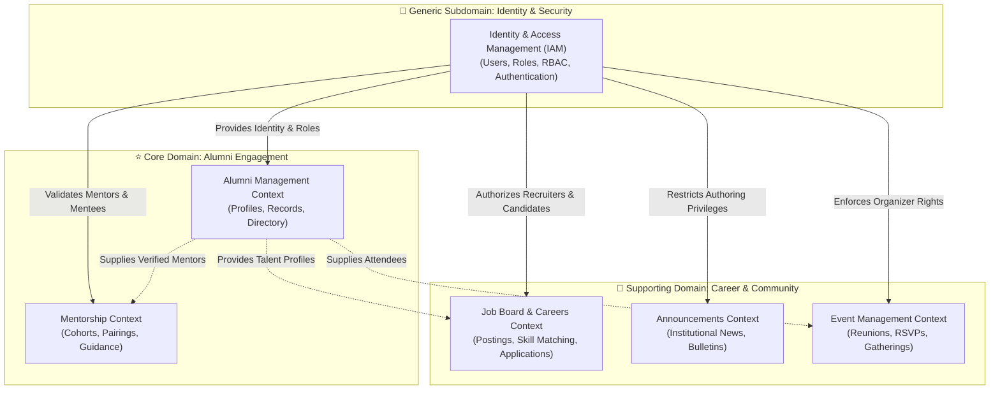
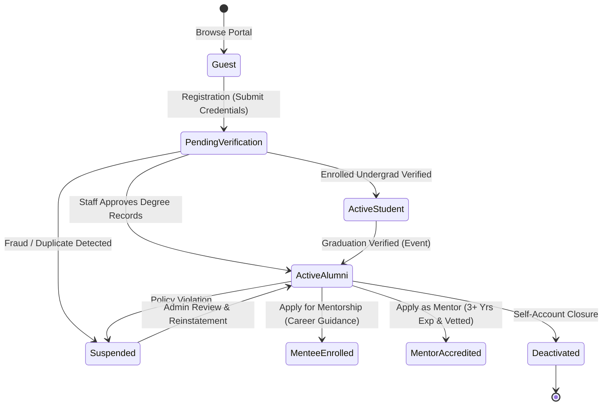
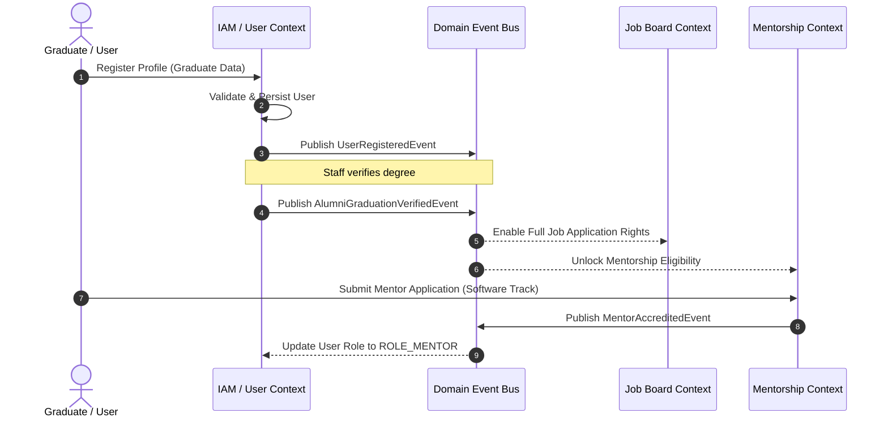

# Domain-Driven Design (DDD) — Alumni Tracking System

This document defines the domain model, bounded contexts, entities, value objects, user personas, role-based access control (RBAC), validation rules, lifecycle state machines, aggregates, and domain invariants for the **Alumni Tracking System**.

---

## 1. Domain Model Overview

The Alumni Tracking System operates within the **Higher Education Alumni & Career Engagement** domain. Its primary mission is to cultivate a lifelong, mutually beneficial relationship between an academic institution and its graduates.

The system addresses four strategic pillars:
1. **Identity & Alumni Directory:** Maintaining verified graduate credentials, career trajectories, academic history, and contact dossiers.
2. **Career & Economic Mobility:** Providing exclusive alumni job boards, corporate recruitment channels, and candidate application workflows.
3. **Knowledge Exchange & Mentorship:** Connecting experienced alumni leaders with recent graduates and seniors across professional tracks.
4. **Institutional Engagement & Community:** Facilitating rectorate announcements, faculty news, class reunions, webinars, and networking meetups.

### 1.1 Context Map & Strategic Architecture



---

## 2. Bounded Contexts

| Context | Subdomain Type | Description | Implementation Status |
|:---|:---|:---|:---|
| **Identity & Access Management (IAM)** | Generic | Central user accounts, authentication credentials, role taxonomy, session security, and access tokens. | ✅ Implemented / Enhanced |
| **Alumni Management** | Core | Graduate directories, profiles, academic records, career histories, skill portfolios, and alumni verification. | ✅ Implemented |
| **Job Board & Applications** | Supporting | Corporate job listings, employment types, compensation transparency, application lifecycle pipelines, and candidate reviews. | ✅ Implemented |
| **Mentorship & Advising** | Core | Cohort tracks (Software, Clinical, Venture, Research), mentor accreditation, mentee applications, and matching cadence. | ✅ Implemented (Views & Workflows) |
| **Announcements** | Supporting | Institutional notifications, priority broadcasting, category classifications (Academic, Career, Event, General). | ✅ Implemented |
| **Event Management** | Supporting | Alumni reunions, webinars, meetups, RSVP tracking, organizer delegation, and capacity planning. | 🔜 Specification Ready |

---

## 3. Users, Personas & Role-Based Access Control (RBAC)

The Alumni Tracking System serves multiple distinct user types spanning university staff, alumni, employers, and prospective graduates. Strict domain invariants govern what each role can create, view, edit, or moderate.

### 3.1 User Personas & Roles

```
┌────────────────────────────────────────────────────────────────────────┐
│                        ROLE TAXONOMY HIERARCHY                         │
│                                                                        │
│                       ┌──────────────────────┐                         │
│                       │  SUPER ADMINISTRATOR │                         │
│                       └──────────┬───────────┘                         │
│                                  │                                     │
│                       ┌──────────▼───────────┐                         │
│                       │ INSTITUTIONAL STAFF  │                         │
│                       │  (Career/Alumni Off.)│                         │
│                       └──────────┬───────────┘                         │
│                                  │                                     │
│        ┌─────────────────────────┼─────────────────────────┐           │
│        ▼                         ▼                         ▼           │
│ ┌──────────────┐         ┌──────────────┐          ┌──────────────┐    │
│ │   ALUMNUS    │         │ ALUMNI MENTOR│          │  EMPLOYER /  │    │
│ │  (Graduate)  │◄───────►│  (Accredited)│          │  RECRUITER   │    │
│ └──────┬───────┘         └──────────────┘          └──────────────┘    │
│        │                                                               │
│        ▼                                                               │
│ ┌──────────────┐                                   ┌──────────────┐    │
│ │ALUMNI MENTEE │                                   │   STUDENT    │    │
│ │(Career Seeker│                                   │(Undergrad/Pre│    │
│ └──────────────┘                                   └──────┬───────┘    │
│                                                           │            │
│        └─────────────────────────┬────────────────────────┘            │
│                                  ▼                                     │
│                       ┌──────────────────────┐                         │
│                       │   GUEST / VISITOR    │                         │
│                       │   (Unauthenticated)  │                         │
│                       └──────────────────────┘                         │
└────────────────────────────────────────────────────────────────────────┘
```

#### 1. System Administrator (`ROLE_ADMIN` / `ADMIN`)
- **Persona:** System Architect, Chief Information Officer, or Central IT Administrator.
- **Responsibilities:**
  - Complete control over system configuration, database management, and service operations.
  - User provisioning, role assignment, account reactivation/suspension, and security audits.
  - Unrestricted read/write access across all bounded contexts.
  - Moderator of all community postings, announcements, and job listings.

#### 2. Institutional Staff & Coordinators (`ROLE_STAFF` / `COORDINATOR`)
- **Persona:** University Career Center (`Kariyer Merkezi`), Rectorate Alumni Relations Office (`Rektörlük Mezun Ofisi`), Faculty Department Heads.
- **Responsibilities:**
  - Reviewing and certifying incoming graduate records and degree validations.
  - Drafting and publishing official institutional announcements and high-priority bulletins.
  - Reviewing and approving external employer job postings to prevent spam or deceptive offers.
  - Organizing official alumni gatherings, commencement reunions, and networking summits.
  - Overseeing mentorship cohort tracks and mediating pairings.

#### 3. Alumnus / Graduate Member (`ROLE_ALUMNI`)
- **Persona:** Verified graduate who holds an associate, bachelor's, master's, or doctoral degree from the institution.
- **Responsibilities:**
  - Maintaining their personal dossier: bio, current location, profile photo, and privacy preferences.
  - Managing their academic graduation history, employment history, and technical/business skills.
  - Browsing the verified Alumni Directory and initiating professional networking with fellow alumni.
  - Searching for career vacancies, reviewing corporate benefits, and submitting job applications.
  - RSVPing to alumni events, regional chapters, and technical conferences.

#### 4. Alumni Mentor (`ROLE_MENTOR`)
- **Persona:** Experienced graduate (typically 3+ years post-graduation or senior/lead professional) accepted into the alumni mentorship initiative.
- **Responsibilities:**
  - Defining mentoring capacity, focus tracks (e.g., *Track 01: Software & AI Engineering*, *Track 02: Clinical & Health Systems*, *Track 03: Venture & Startup Incubation*, *Track 04: Postgrad Research*).
  - Setting preferred communication cadence (bi-weekly, monthly) and availability windows.
  - Reviewing assigned mentee dossiers, providing portfolio feedback, conducting mock technical interviews, and offering career transition guidance.

#### 5. Alumni Mentee (`ROLE_MENTEE`)
- **Persona:** Recent graduate, career switcher, or postgraduate alumnus seeking professional direction and industry insights.
- **Responsibilities:**
  - Submitting mentorship intent applications specifying career targets, preferred cohort track, and target mentors.
  - Attending scheduled mentorship syncs, respecting mentor availability, and completing agreed development action items.

#### 6. Corporate Recruiter / Employer (`ROLE_EMPLOYER` / `RECRUITER`)
- **Persona:** Talent Acquisition Partner, Engineering Manager, HR Specialist, or Verified Corporate Partner (e.g. Trendyol, Google, Getir, Aselsan).
- **Responsibilities:**
  - Publishing corporate job openings with comprehensive criteria (employment type, workplace setup, salary bands, required skills).
  - Reviewing submitted candidate applications (`job_applications`), downloading applicant dossiers, and evaluating CVs.
  - Progressing candidates through review pipelines (`submitted` → `in_review` → `interview_scheduled` → `shortlisted` → `offered` / `rejected`).
  - Maintaining employer profile and talent acquisition contact information.

#### 7. Student / Prospective Graduate (`ROLE_STUDENT`)
- **Persona:** Currently enrolled university student in their senior year or approaching graduation.
- **Responsibilities:**
  - Viewing open internships, co-op opportunities, and junior vacancies posted by alumni partners.
  - Applying for transition mentorship or graduating cohort preparation.
  - Upon graduation verification by Institutional Staff, their role automatically transitions from `ROLE_STUDENT` to `ROLE_ALUMNI`.

#### 8. Guest / Public Visitor (`ROLE_GUEST`)
- **Persona:** Unauthenticated visitor browsing the public web portal.
- **Responsibilities:**
  - Browsing public landing pages (Home, About Us, Brand Guidelines, API Swagger documentation).
  - Viewing public announcement headlines and general university news.
  - Initiating user registration or alumni verification requests.

---

### 3.2 Role-Based Access Control (RBAC) Permission Matrix

The following matrix specifies domain permissions across aggregates and actions:

| Domain Resource / Action | Guest | Student | Alumni | Mentor | Mentee | Employer | Staff | Admin |
|:---|:---:|:---:|:---:|:---:|:---:|:---:|:---:|:---:|
| **Alumni Directory** | | | | | | | | |
| View Public Alumni Directory | ❌ | 👁️ Read | 👁️ Read | 👁️ Read | 👁️ Read | 👁️ Read | 👁️ Read | 👁️ Read |
| View Detailed Alumni Dossier | ❌ | ❌ | 👁️ Read | 👁️ Read | 👁️ Read | 👁️ Read | 👁️ Read | 👁️ Read |
| Create User / Register | ✍️ Own | ❌ | ❌ | ❌ | ❌ | ❌ | ✍️ Any | ✍️ Any |
| Update Profile & Personal Info | ❌ | ✍️ Own | ✍️ Own | ✍️ Own | ✍️ Own | ✍️ Own | ✍️ Any | ✍️ Any |
| Delete User Profile | ❌ | ❌ | ❌ | ❌ | ❌ | ❌ | ⚠️ Verify | ✍️ Any |
| Manage User Roles / Suspensions | ❌ | ❌ | ❌ | ❌ | ❌ | ❌ | ❌ | ✍️ Any |
| **Academic & Career Records** | | | | | | | | |
| View Academic & Work History | ❌ | 👁️ Own | 👁️ Read | 👁️ Read | 👁️ Read | 👁️ Read | 👁️ Read | 👁️ Read |
| Add / Edit Own Work History | ❌ | ✍️ Own | ✍️ Own | ✍️ Own | ✍️ Own | ❌ | ✍️ Any | ✍️ Any |
| Verify Official Graduation Record| ❌ | ❌ | ❌ | ❌ | ❌ | ❌ | ✍️ Approve| ✍️ Approve|
| **Job Postings & Careers** | | | | | | | | |
| Browse Open Job Postings | 👁️ Public| 👁️ Read | 👁️ Read | 👁️ Read | 👁️ Read | 👁️ Read | 👁️ Read | 👁️ Read |
| View Salary Bands & Details | ❌ | 👁️ Read | 👁️ Read | 👁️ Read | 👁️ Read | 👁️ Read | 👁️ Read | 👁️ Read |
| Publish Job Postings | ❌ | ❌ | ✍️ Submit*| ✍️ Submit*| ❌ | ✍️ Own | ✍️ Any | ✍️ Any |
| Edit / Close Own Job Posting | ❌ | ❌ | ✍️ Own | ✍️ Own | ❌ | ✍️ Own | ✍️ Any | ✍️ Any |
| Delete Any Job Posting | ❌ | ❌ | ❌ | ❌ | ❌ | ❌ | ✍️ Moderate| ✍️ Any |
| **Job Applications** | | | | | | | | |
| Submit Job Application | ❌ | ✍️ Intern | ✍️ Own | ✍️ Own | ✍️ Own | ❌ | ❌ | ✍️ Test |
| View Own Application Status | ❌ | 👁️ Own | 👁️ Own | 👁️ Own | 👁️ Own | ❌ | 👁️ Any | 👁️ Any |
| View Applicants for Job Posting | ❌ | ❌ | ❌ | ❌ | ❌ | 👁️ Own Post| 👁️ Any | 👁️ Any |
| Progress Application Pipeline | ❌ | ❌ | ❌ | ❌ | ❌ | ✍️ Own Post| ✍️ Any | ✍️ Any |
| **Mentorship** | | | | | | | | |
| View Mentorship Tracks | 👁️ Read | 👁️ Read | 👁️ Read | 👁️ Read | 👁️ Read | 👁️ Read | 👁️ Read | 👁️ Read |
| Apply as Alumni Mentor | ❌ | ❌ | ✍️ Submit | 👁️ Active| ❌ | ❌ | ❌ | ✍️ Any |
| Apply as Alumni Mentee | ❌ | ✍️ Submit| ✍️ Submit| ❌ | 👁️ Active| ❌ | ❌ | ✍️ Any |
| Approve / Pair Mentorship Match | ❌ | ❌ | ❌ | ❌ | ❌ | ❌ | ✍️ Pair | ✍️ Pair |
| **Announcements** | | | | | | | | |
| View Public Announcements | 👁️ Read | 👁️ Read | 👁️ Read | 👁️ Read | 👁️ Read | 👁️ Read | 👁️ Read | 👁️ Read |
| Create / Publish Announcement | ❌ | ❌ | ❌ | ❌ | ❌ | ❌ | ✍️ Create| ✍️ Create|
| Edit / Delete Announcement | ❌ | ❌ | ❌ | ❌ | ❌ | ❌ | ✍️ Own | ✍️ Any |
| **Events** | | | | | | | | |
| View Events Calendar | 👁️ Public| 👁️ Read | 👁️ Read | 👁️ Read | 👁️ Read | 👁️ Read | 👁️ Read | 👁️ Read |
| RSVP / Register to Attend | ❌ | ✍️ Allowed| ✍️ Allowed| ✍️ Allowed| ✍️ Allowed| ✍️ Allowed| ✍️ Allowed| ✍️ Allowed|
| Create & Organize Event | ❌ | ❌ | ✍️ Propose| ✍️ Propose| ❌ | ✍️ Partner| ✍️ Create| ✍️ Create|
| Cancel / Delete Event | ❌ | ❌ | ❌ | ❌ | ❌ | ❌ | ✍️ Moderate| ✍️ Any |

*\* Note: Alumni members can submit community job referrals; institutional policy flags them for verification or direct publishing based on trust tier.*

---

## 4. Entity Definitions & Validation Rules

### 4.1 User / Alumni Entity (Core Aggregate Root)

The `User` entity represents any authenticated actor within the Alumni ecosystem.

**Full Schema:**

| Field | Type | Required | Constraints | Description |
|:---|:---|:---:|:---|:---|
| `id` | BigInt / Number | Auto-gen | Unique, positive integer, immutable | Unique identifier |
| `name` | String | ✅ Yes | Min 1 char, max 100 chars, trimmed, no symbols | First name |
| `surname` | String | ✅ Yes | Min 1 char, max 100 chars, trimmed, no symbols | Last name |
| `email` | String | ✅ Yes | Unique, valid RFC 5322 format, lowercase | Institutional / primary email |
| `password_hash` | String | ❌ Partial | Min 60 chars (bcrypt / argon2) | Secure hash of account credentials |
| `role` | String (Enum) | ✅ Yes | Default: `alumni`. Enum: `admin`, `staff`, `alumni`, `mentor`, `mentee`, `employer`, `student`, `guest` | Primary security role |
| `status` | String (Enum) | ✅ Yes | Default: `active`. Enum: `pending_verification`, `active`, `suspended`, `graduated`, `deactivated` | Account operational state |
| `age` | Number | ✅ Yes | Integer, range 0–120 | Age of the individual |
| `birthday` | String | ✅ Yes | Format: `YYYY-MM-DD`, valid calendar date, past only | Date of birth |
| `phone` | String | ❌ No | Max 30 chars, E.164 or local format | Contact telephone number |
| `profile_image_url`| String | ❌ No | Max 500 chars, valid URI or empty | Avatar / portrait link |
| `city` | String | ❌ No | Max 100 chars | Current residence / operating city |
| `country` | String | ❌ No | Default: `'Türkiye'`, max 100 chars | Country of residence |
| `bio` | String | ❌ No | Max 2000 chars | Professional biography / summary |
| `created_at` | Timestamp | Auto-gen | ISO 8601 / TIMESTAMPTZ | Creation timestamp |
| `updated_at` | Timestamp | Auto-gen | ISO 8601 / TIMESTAMPTZ | Last update timestamp |

**Validation Rules:**
1. **name & surname:** Required. Must not be blank after trimming. Maximum 100 characters each. Disallow executable scripts or HTML tags.
2. **email:** Required. Must match standard email pattern `^[^@\s]+@[^@\s]+\.[^@\s]+$`. Converted to lowercase. Must be unique across all active accounts.
3. **role:** Required. Must strictly match one of the predefined domain roles: `admin`, `staff`, `alumni`, `mentor`, `mentee`, `employer`, `student`, `guest`. Only `admin` can assign `admin` or `staff` roles.
4. **status:** Required. Must be one of `pending_verification`, `active`, `suspended`, `graduated`, `deactivated`.
5. **age:** Required. Must be a non-negative integer between 0 and 120. Must be logically consistent with `birthday` (within a ±1 year tolerance for leap years).
6. **birthday:** Required. Must follow `YYYY-MM-DD` and be a valid date strictly prior to the current system date.
7. **id:** Read-only and immutable. Client-provided IDs in `POST` payloads must be rejected or stripped.

---

### 4.2 User Value Objects

#### 1. `UserRole` (Value Object)
- Represents the authorization boundary of the identity.
- Encapsulates role comparisons, hierarchy checks, and policy evaluations:
  - `role.canModerate()` → true for `admin`, `staff`
  - `role.canPostJob()` → true for `admin`, `staff`, `employer`, `alumni`
  - `role.canApply()` → true for `alumni`, `mentee`, `student`
  - `role.isVerifiedAlumni()` → true for `alumni`, `mentor`, `mentee`
- Invariant: A user cannot downgrade their own role if they are the sole surviving `admin`.

#### 2. `UserStatus` (Value Object)
- Governs login capability and profile visibility:
  - `active`: Normal access, public directory inclusion (unless opted out).
  - `pending_verification`: Can log in, but cannot apply to jobs or access full alumni contact info until academic records are validated by Staff.
  - `suspended`: Login revoked due to policy violation or investigation.
  - `deactivated`: Self-requested closure; soft-deleted; personal contact info wiped.

#### 3. `EmailAddress` (Value Object)
- Immutable, self-validating string object.
- Differentiates institutional emails (`@alumni.edu`, `@universite.edu.tr`) from external personal addresses (`@gmail.com`).
- Enforces normalized lowercase comparison.

---

### 4.3 Academic Record Entity (Supporting User Aggregate)

Represents formal educational achievements granted by the institution.

| Field | Type | Required | Constraints | Description |
|:---|:---|:---:|:---|:---|
| `id` | BigInt | Auto-gen | Unique positive integer | Record ID |
| `user_id` | BigInt | ✅ Yes | FK to `users.id` (ON DELETE CASCADE) | Referenced alumnus |
| `degree_level` | String | ✅ Yes | Enum: `Associate`, `Bachelor`, `Master`, `Doctorate` | Degree type |
| `faculty` | String | ✅ Yes | Max 150 chars | Faculty name |
| `department` | String | ✅ Yes | Max 150 chars | Degree department |
| `student_number` | String | ❌ No | Max 50 chars | Original institutional student ID |
| `start_year` | Number | ✅ Yes | SmallInt, range 1950–Current Year | Matriculation year |
| `graduation_year`| Number | ✅ Yes | SmallInt, graduation_year >= start_year | Completion year |
| `gpa` | Number | ❌ No | Decimal 0.00 to 4.00 | Grade point average |
| `is_verified` | Boolean | System | Default: `false` | Verified by Career/Alumni Office |

---

### 4.4 Job Posting Entity

Represents employment, internship, or contract opportunities targeted at the alumni community.

| Field | Type | Required | Constraints | Description |
|:---|:---|:---:|:---|:---|
| `id` | BigInt | Auto-gen | Unique, positive integer | Job identifier |
| `company_name` | String | ✅ Yes | Min 1, max 200 chars | Hiring company / organization |
| `title` | String | ✅ Yes | Min 1, max 150 chars | Role / position title |
| `category` | String | ❌ No | Max 100 chars (e.g. 'Software', 'DevOps') | Professional discipline |
| `description` | String | ✅ Yes | Non-empty, max 5000 chars | Detailed role summary & duties |
| `requirements` | String | ❌ No | Text bullet points | Skills, credentials & experience |
| `benefits` | String | ❌ No | Text bullet points | Perks, health, ESOP, equipment |
| `employment_type`| String | ✅ Yes | Default: `full-time`. Enum: `full-time`, `part-time`, `contract`, `internship` | Job modality |
| `workplace_type` | String | ❌ No | Default: `hybrid`. Enum: `on-site`, `hybrid`, `remote` | Office arrangement |
| `experience_level`| String | ❌ No | Enum: `intern`, `entry`, `mid`, `senior`, `lead`, `executive` | Seniority tier |
| `location` | String | ✅ Yes | Max 100 chars | City, Region, or Remote scope |
| `salary_min` | Number | ❌ No | Non-negative integer | Floor compensation |
| `salary_max` | Number | ❌ No | salary_max >= salary_min | Ceiling compensation |
| `currency` | String | ❌ No | Default: `'TRY'`, ISO 3-letter code (TRY, USD, EUR) | Monetary unit |
| `is_salary_visible`| Boolean | ❌ No | Default: `true` | Public salary visibility flag |
| `application_url` | String | ❌ No | Valid URL | External application link |
| `contact_email` | String | ❌ No | Valid email | Recruiter direct inbox |
| `deadline` | String | ❌ No | Date format `YYYY-MM-DD` | Submission closing date |
| `status` | String | ✅ Yes | Default: `open`. Enum: `draft`, `open`, `closed`, `archived` | Listing state |
| `is_featured` | Boolean | ❌ No | Default: `false` | Highlighted on homepage |
| `views_count` | Number | System | Non-negative counter | Total impressions counter |

---

### 4.5 Job Application Entity

Connects an Alumnus / Candidate with a Job Posting.

| Field | Type | Required | Constraints | Description |
|:---|:---|:---:|:---|:---|
| `id` | BigInt | Auto-gen | Unique integer | Application ID |
| `job_id` | BigInt | ✅ Yes | FK to `job_postings.id` | Target job |
| `user_id` | BigInt | ✅ Yes | FK to `users.id` | Candidate alumnus / student |
| `cover_letter` | String | ❌ No | Max 4000 chars | Motivation statement |
| `resume_url` | String | ❌ No | Valid URL or file path | Attached CV |
| `expected_salary`| Number | ❌ No | Non-negative number | Candidate expectations |
| `notice_period_days`| Number| ❌ No | Non-negative integer (e.g. 0, 15, 30) | Availability window |
| `status` | String | ✅ Yes | Default: `submitted`. Enum: `submitted`, `in_review`, `interview_scheduled`, `shortlisted`, `offered`, `accepted`, `rejected`, `withdrawn` | Pipeline status |
| `applied_at` | Timestamp | Auto-gen | TIMESTAMPTZ | Submission timestamp |

**Invariants:**
- A user can only maintain **one** active application per job listing `(job_id, user_id)` unique constraint.
- An application can only be transitioned to `withdrawn` by the owning candidate.
- Statuses `in_review`, `interview_scheduled`, `shortlisted`, `offered`, `rejected` can only be set by the posting Employer, Staff, or Admin.

---

### 4.6 Announcement Entity

Represents institutional broadcasts issued by University Administration.

| Field | Type | Required | Constraints | Description |
|:---|:---|:---:|:---|:---|
| `id` | BigInt | Auto-gen | Unique integer | Announcement ID |
| `title` | String | ✅ Yes | Min 1, max 255 chars | Bulletin headline |
| `content` | String | ✅ Yes | Min 1 char | Full markdown/HTML body |
| `author` | String | ✅ Yes | Max 100 chars (e.g. 'Rektörlük Mezun Ofisi') | Issuing authority |
| `category` | String | ✅ Yes | Default: `'Genel'`. Enum: `Genel`, `Kariyer`, `Akademik`, `Etkinlik` | Classification |
| `priority` | String | ✅ Yes | Default: `'Normal'`. Enum: `Düşük`, `Normal`, `Önemli`, `Acil` | Urgency tier |
| `date` | String | ✅ Yes | `YYYY-MM-DD` | Date of release |

**Invariant:** Only users with `ROLE_ADMIN` or `ROLE_STAFF` are authorized to author, update, or remove announcements.

---

## 5. User Lifecycle & State Machine



### 5.1 Lifecycle Transitions & Domain Invariants

1. **Registration & Vetting (`Guest` → `PendingVerification`):**
   - The user registers with name, surname, email, age, and birthday.
   - If an institutional student number is supplied, an automated matching service cross-references student graduation registries.
   - If match is definitive, status updates to `active` (`ROLE_ALUMNI`). If manual audit is required, user remains `pending_verification`.

2. **Graduation Event Transition (`ROLE_STUDENT` → `ROLE_ALUMNI`):**
   - When institutional degree conferral occurs, a `StudentGraduatedDomainEvent` triggers.
   - Role upgrades from `student` to `alumni`.
   - Access to full alumni directory dossiers, exclusive job applications, and career networking unlocks.

3. **Mentorship Accreditation (`ROLE_ALUMNI` → `ROLE_MENTOR`):**
   - An alumnus registers interest via the Mentorship portal (`mentorship.html`).
   - Prerequisites: verified alumnus status, minimum recorded work experience in selected track (Software, Clinical, Venture, Research).
   - Staff approves application → user granted `mentor` capabilities while preserving their base `alumni` profile.

4. **Account Suspension & Revocation:**
   - Initiated exclusively by `ADMIN` or senior `STAFF`.
   - Disables authentication immediately; active sessions are invalidated; active job applications or postings are paused.

---

## 6. Aggregates & Boundaries

### 6.1 User Aggregate (Aggregate Root)

The `User` is the core Aggregate Root ensuring internal consistency across personal, academic, and professional milestones.

```
┌────────────────────────────────────────────────────────┐
│                      USER AGGREGATE                    │
│                                                        │
│  ┌──────────────────────────────────────────────────┐  │
│  │ User (Aggregate Root)                            │  │
│  │ - id: BigInt                                     │  │
│  │ - name, surname, email, age, birthday            │  │
│  │ - role: UserRole (VO)                            │  │
│  │ - status: UserStatus (VO)                        │  │
│  │ - city, country, phone, bio, profile_image_url   │  │
│  └─────────────────────────┬────────────────────────┘  │
│                            │ 1:N                       │
│        ┌───────────────────┼───────────────────┐       │
│        ▼                   ▼                   ▼       │
│ ┌───────────────┐ ┌─────────────────┐ ┌──────────────┐ │
│ │AcademicRecord │ │ WorkExperience  │ │ AlumniSkill  │ │
│ │ (Entity)      │ │   (Entity)      │ │   (Entity)   │ │
│ └───────────────┘ └─────────────────┘ └──────────────┘ │
└────────────────────────────────────────────────────────┘
```

**Aggregate Invariants:**
- Every `AcademicRecord`, `WorkExperience`, and `AlumniSkill` must belong to a parent `User`. They cannot exist independently.
- Deleting a `User` cascades to delete their associated academic records, work experiences, and skill associations.
- The `User` root enforces that total associated skills do not exceed 50 per individual to prevent directory bloat.
- The `User` root enforces that graduation year in academic records cannot predate birth year + 15 years.

### 6.2 Job Posting Aggregate
- **Root Entity:** `JobPosting`
- **Associated Value Objects:** `CompensationRange` (min, max, currency, is_visible), `LocationSpec` (location, workplace_type).
- **Invariants:**
  - `salary_max >= salary_min` when both are defined.
  - An open job posting must contain at least one valid contact channel (`application_url` or `contact_email`).

### 6.3 Job Application Aggregate
- **Root Entity:** `JobApplication`
- **References:** `job_id` (JobPosting), `user_id` (User)
- **Invariants:**
  - Unique composite invariant: No duplicate applications for `(job_id, user_id)`.
  - Only candidates with role `alumni`, `mentee`, or `student` can instantiate an application.

### 6.4 Announcement Aggregate
- **Root Entity:** `Announcement`
- **Value Objects:** `AnnouncementPriority`, `AnnouncementCategory`
- **Invariants:**
  - Must have an identifiable author and valid release date.
  - Creation restricted to administrative roles.

---

## 7. Domain Services

| Domain Service | Responsibility |
|:---|:---|
| `UserValidationService` | Validates personal attributes (names, dates, age consistency, email format) prior to database transaction. |
| `AuthorizationPolicyService` | Evaluates caller roles against requested actions and resources (RBAC enforcement). |
| `GraduationVerificationService` | Reconciles incoming user registration with official institutional student registries to certify alumni authenticity. |
| `JobApplicationLifecycleService`| Enforces valid status transitions (`submitted` → `in_review` → `interview_scheduled` etc.) and candidate notification triggers. |
| `MentorshipCohortService` | Evaluates mentor credentials, verifies track alignment, balances cohort capacity, and generates pairings. |

---

## 8. Domain Events

Domain Events represent significant business occurrences within the Alumni system, published across context boundaries to trigger secondary workflows:



### Event Definitions

1. `UserRegisteredEvent`
   - **Payload:** `{ userId, email, role, registeredAt }`
   - **Reaction:** Sends confirmation email and queues dossier for verification.

2. `AlumniGraduationVerifiedEvent`
   - **Payload:** `{ userId, degreeLevel, faculty, department, graduationYear, verifiedBy }`
   - **Reaction:** Activates full alumni directory badge and unlocks career board access.

3. `RoleChangedEvent`
   - **Payload:** `{ userId, previousRole, newRole, changedBy, timestamp }`
   - **Reaction:** Updates security tokens and logs security audit trail.

4. `MentorAccreditedEvent`
   - **Payload:** `{ mentorId, cohortTrack, cadence, accreditedAt }`
   - **Reaction:** Displays mentor card in Mentorship directory (`mentorship.html`).

5. `JobApplicationSubmittedEvent`
   - **Payload:** `{ applicationId, jobId, candidateUserId, appliedAt }`
   - **Reaction:** Notifies posting employer and increments job application counter.

6. `UserSuspendedEvent`
   - **Payload:** `{ userId, reason, suspendedBy, timestamp }`
   - **Reaction:** Invalidates active web sessions, hides profile from directory, pauses active applications.

---

## 9. Error Handling & Security Strategy

All API endpoints and MVC controllers enforce standardized domain response semantics:

- **HTTP 400 (Bad Request):** Invalid entity payload, missing required schema fields, or failed value object validations.
- **HTTP 401 (Unauthorized):** Unauthenticated caller attempting to reach protected resources.
- **HTTP 403 (Forbidden):** Authenticated user lacks required role permissions per the RBAC matrix (e.g. an Alumnus attempting to publish an official Announcement).
- **HTTP 404 (Not Found):** Requested resource (User, Job, Announcement, Application) does not exist.
- **HTTP 409 (Conflict):** Duplicate identity submission (e.g. duplicate email, or duplicate job application for the same posting).
- **HTTP 422 (Unprocessable Entity):** Domain business invariant violation (e.g. attempting to close a job posting that is already archived).
- **HTTP 500 (Internal Server Error):** Unexpected infrastructure, connection pool, or database persistence failure.

---

*Document Version: 2.0.0*  
*Last updated: November 25, 2026*  
*Domain Scope: Alumni Management, Identity & Access Control (RBAC), Careers, Mentorship, Announcements*
